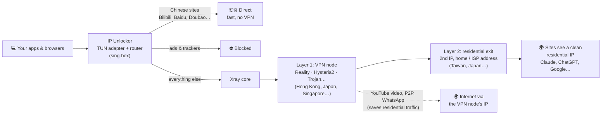

# IP Unlocker — VPN client for Windows & macOS (Xray / sing-box)

**IP Unlocker** is a simple, fast **VPN and proxy client for Windows 10/11 and macOS** (Apple Silicon and Intel), built on **Xray-core** and **sing-box**. Paste your server link (**VLESS, Reality, VMess, Trojan, Shadowsocks, Hysteria2, TUIC, AnyTLS**) or a **Clash subscription**, press *Connect*: the app picks the fastest node, protects the whole computer with a **TUN** adapter and a **kill switch**, and keeps Chinese sites fast by sending them **direct**.

Interface in **English, Chinese and French**.

## ⬇ Download

Always the latest version:

| Computer | Download |
|---|---|
| **Windows 10 / 11** | [⬇ IP-Unlocker-Windows.exe](https://github.com/Paquereauman/cu-bootstrap/releases/latest/download/IP-Unlocker-Windows.exe) |
| **Mac M1, M2, M3, M4** (Apple Silicon) | [⬇ IP-Unlocker-Mac-AppleSilicon.zip](https://github.com/Paquereauman/cu-bootstrap/releases/latest/download/IP-Unlocker-Mac-AppleSilicon.zip) |
| **Mac Intel** | [⬇ IP-Unlocker-Mac-Intel.zip](https://github.com/Paquereauman/cu-bootstrap/releases/latest/download/IP-Unlocker-Mac-Intel.zip) |

**Which Mac?**  menu › About This Mac: "Chip Apple M…" = Apple Silicon, "Processor Intel" = Intel.

**Mac (macOS 15):** unzip, open Terminal, type `bash ` (with a space), drag the file *Installer IP Unlocker.command* into the window and press Enter (no password needed).

**Already installed?** Settings › Updates › Check. The app also updates itself automatically.

All versions: [Releases](https://github.com/Paquereauman/cu-bootstrap/releases)

## 🧭 How it works: 2 layers

- **Layer 1, the VPN node**, gets you out of the local network: an encrypted, hard-to-detect tunnel (VLESS Reality, Hysteria2…). The app tests every node and always uses the fastest one, with a standby node ready.
- **Layer 2, the residential exit** (optional): the traffic leaves the VPN node through a residential / ISP proxy, so websites see an ordinary home IP instead of a datacenter IP. This is what keeps accounts such as **Claude** safe: Claude is only allowed through this 2nd IP.
- **Kill switch:** if layer 1 stops answering, foreign traffic is blocked instead of leaking your real IP.
- **Direct lane:** Chinese sites never enter the tunnel, so they stay as fast as without a VPN.

## ✨ Features

- **One-click connect** — paste a `vless://`, `vmess://`, `trojan://`, `ss://`, `hysteria2://`, `tuic://` or `anytls://` link, or import a **Clash / Mihomo YAML subscription**.
- **Fastest node, automatically** — every node is tested in the background; the app switches to a better one at a quiet moment and keeps a **standby node** ready for an instant switch.
- **Whole-computer VPN (TUN mode)** or **system proxy** mode.
- **Kill switch** — if no server answers, foreign traffic is blocked so your real IP never leaks.
- **Chinese sites go direct (split tunneling)** — Bilibili, Douyin, iQiyi, Tencent Video, WeChat, Taobao, Baidu, DeepSeek, Doubao, Kimi… stay fast and keep their full Chinese catalogues.
- **Ad & tracker blocking** in every app and browser.
- **Residential exit proxies** — chain a residential / ISP proxy after the VPN node for a clean exit IP (videos and P2P can skip it to save traffic).
- **Claude account protection** — Claude only goes through the VPN and a residential exit (2nd IP), and is blocked on servers in a region Anthropic does not serve; ChatGPT, Gemini and Google always go through the VPN too.
- **Repair browsers** — one click fixes slow Chinese sites in Brave, Chrome and Edge (DNS and browser settings reset, tabs restored).
- **Privacy hardening** — WebRTC leak protection, WebGL / GPU fingerprint hiding, time zone and browser language matched to the exit country, QUIC blocking.
- **Game mode** — games skip the VPN; works alongside UU, Leigod and Xunyou accelerators.
- **Share to phone** — QR code for v2rayNG, Hiddify or Streisand.
- **Automatic updates**, start with the computer, light and native (no Electron).

## 🔌 Supported protocols

VLESS (Reality, Vision, XHTTP, WebSocket, gRPC) · VMess · Trojan · Shadowsocks · Hysteria2 · Hysteria · TUIC · AnyTLS · HTTP / SOCKS exit proxies · Clash subscriptions

Engines: [Xray-core](https://github.com/XTLS/Xray-core) and [sing-box](https://github.com/SagerNet/sing-box).

## ❓ FAQ

**What do I need?** A VPN server link or a Clash subscription (any provider), or the e-mail and password of the account you were given.

**Does it work in China?** Yes — it was made for it: Reality / Hysteria2 / fragmenting help connections through, and Chinese sites stay direct and fast.

**Windows SmartScreen shows a warning.** Click *More info › Run anyway*. The app needs administrator rights to create the TUN adapter.

**Can I use it like v2rayN, Clash Verge or Hiddify?** Yes: it reads the same links and Clash subscriptions, with automatic node selection and a kill switch built in.

---

Keywords: VPN client Windows, VPN Mac, Xray client, sing-box GUI, v2ray client, VLESS Reality client, Hysteria2 client, Clash subscription, TUN mode, kill switch, split tunneling China, bypass GFW, Claude in China, ChatGPT in China.
